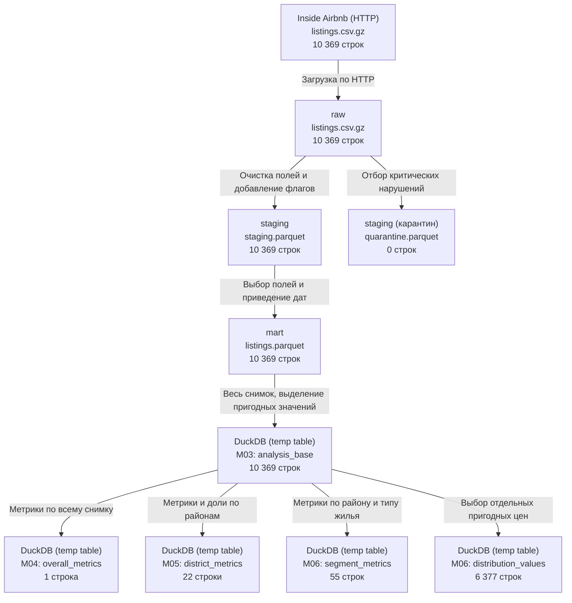

# Маршрут данных Airbnb Amsterdam

## Контекст анализа

### Вопрос

Как различаются заявленные суточные цены и календарная доступность между районами
при сравнении одинаковых типов жилья?

### Выбранное значение метрики

Для разбора выбрана медианная заявленная цена целого жилья в районе
De Baarsjes - Oud-West — **357,00 евро за ночь**.
В этой группе **1 633 объявления**, из них **901 цена** вошла в расчет.
Использован снимок Inside Airbnb от 15 июня 2026 года. Данные собирались
15–24 июня 2026 года.

### Исходные данные

Объявления загружены по HTTP из файла
[listings.csv.gz](https://data.insideairbnb.com/the-netherlands/north-holland/amsterdam/2026-06-15/data/listings.csv.gz)
от Inside Airbnb. Загрузку в SeaweedFS выполнил DAG Airflow `ingest_raw`.
Логическая дата загрузки — 23 октября 2026 года.

| Исходные данные          | Путь в `raw`                                                                |
| ------------------------ | --------------------------------------------------------------------------- |
| Объявления Inside Airbnb | `s3://raw/airbnb_amsterdam_listings/ingested_on=2026-10-23/listings.csv.gz` |

## Схема происхождения данных (data lineage)

| Переход                                   | Реализация и проверки                                                                                                                                                                                                                                                                                                                                             |
| ----------------------------------------- | ----------------------------------------------------------------------------------------------------------------------------------------------------------------------------------------------------------------------------------------------------------------------------------------------------------------------------------------------------------------- |
| Источник --> `raw`                        | В [ingest_raw.py](../airflow/dags/ingest_raw.py) задача `wait_for_primary_source` проверяет URL, а `load_to_raw` сохраняет файл. Обе задачи завершились успешно, см. [результат DAG](evidence/airflow_seaweedfs.json).                                                                                                                                            |
| `raw` --> `staging` и `quarantine`        | В [profile_quality.ipynb](../notebooks/profile_quality.ipynb) проверяются ключ `id`, категории, цены и календарь. Пропуски цены помечаются флагом. В [отчете о качестве](data_quality_report.md#4-подготовленные-данные) зафиксирован баланс: 10 369 исходных строк, 10 369 в `staging`, 0 в карантине.                                                           |
| `staging` --> `mart`                      | В [build_mart.ipynb](../notebooks/build_mart.ipynb#checks) выбираются поля, район переименовывается в `district`, даты приводятся к `DATE`. Соединений таблиц нет. После записи проверено, что все 10 369 строк перенесены, а `id` заполнен и уникален.                                                                                                           |
| `mart` --> `analysis_base` --> результаты | В [calculate_metrics.ipynb](../notebooks/calculate_metrics.ipynb#intro) M03 читает весь снимок и выделяет пригодные цены и календарные значения. M04–M06 считают итоги и готовят выборку. В [M07](../notebooks/calculate_metrics.ipynb#validation) пройдены шесть проверок, включая сверку количества объявлений, числа пригодных значений и суммы долей районов. |

| Датасет      | Путь                                                                                      |
| ------------ | ----------------------------------------------------------------------------------------- |
| `staging`    | `s3://staging/airbnb_amsterdam_listings/source_ingested_on=2026-10-23/staging.parquet`    |
| `quarantine` | `s3://staging/airbnb_amsterdam_listings/source_ingested_on=2026-10-23/quarantine.parquet` |
| `mart`       | `s3://mart/airbnb_amsterdam_listings/source_ingested_on=2026-10-23/listings.parquet`      |

## Маршрут данных для выбранного значения метрики

От значения 357,00 евро можно пройти через SQL и витрину до исходных данных.

1. В [calculate_metrics.ipynb](../notebooks/calculate_metrics.ipynb#intro)
   в ячейке M06 найдите таблицу «Два района с наибольшим числом объявлений целого жилья».
   В строке `De Baarsjes - Oud-West` / `Entire home/apt` столбец `median_price_eur`
   показывает `357.00`, `price_count` — `901`, `listings_count` — `1633`.
   Запрос для `segment_metrics` группирует `analysis_base` по `district` и
   `room_type` и считает `median(CAST(valid_price_eur AS DECIMAL(15,3)))`.
   При 901 пригодной цене медиана — 451-е значение после сортировки. При выводе
   результат округляется до центов.
2. M03 читает `listings.parquet` и переносит в `analysis_base` все объявления снимка.
   В `valid_price_eur` попадает только положительная цена, для которой оба флага
   `flag_price_missing` и `flag_price_invalid` равны `false`. В остальных
   случаях поле получает `NULL`. Такие объявления учитываются в `listings_count`,
   а `median` и `count(valid_price_eur)` пропускают их цены. В выбранной группе
   это 732 объявления.
3. В `build_mart.ipynb` витрину собирают из `staging.parquet`. Название района
   получает имя `district`, тип жилья, цену и флаги переносят без изменений.
   В `profile_quality.ipynb` эти поля получают из CSV в слое `raw`. У района и типа жилья убирают крайние пробелы, а у цены —
   знак валюты и запятые. Пригодные цены переводят в `DECIMAL(14,2)`. Пропуск
   и некорректную цену отмечают двумя отдельными флагами.

### Словарь ключевых полей

| Поле витрины         | Смысл, тип и единица измерения                 | Источник, преобразование и роль                                                                                                                                                                                |
| -------------------- | ---------------------------------------------- | -------------------------------------------------------------------------------------------------------------------------------------------------------------------------------------------------------------- |
| `id`                 | Идентификатор объявления, `VARCHAR`            | Из `raw.id` в `staging.id` как строка, затем переносится в витрину. Используется в `count(DISTINCT id)` для подсчета всех объявлений группы.                                                                   |
| `district`           | Район, `VARCHAR`                               | Из `raw.neighbourhood_cleansed` убирают крайние пробелы. В `staging` имя поля сохраняется, в витрине его меняют на `district`. Поле задает район группировки.                                                  |
| `room_type`          | Тип жилья, `VARCHAR`                           | Из `raw.room_type` убирают крайние пробелы и проверяют категорию. Из `staging.room_type` переносится в витрину. Поле уточняет группировку и позволяет выбрать `Entire home/apt`.                               |
| `price_eur`          | Заявленная цена, `DECIMAL(14,2)`, евро за ночь | `raw.price` очищается и преобразуется в `staging.price_eur`, затем переносится в витрину. Из пригодных значений M03 формирует `valid_price_eur` для расчета медианы.                                           |
| `flag_price_missing` | Признак пропуска цены, `BOOLEAN`               | В `staging` вычисляется из `raw.price`, переносится в витрину. Флаг равен `true` при пустой или отсутствующей цене. Используется в условии отбора M03.                                                         |
| `flag_price_invalid` | Признак некорректной цены, `BOOLEAN`           | В `staging` вычисляется из того же `raw.price`, переносится в витрину. Флаг отмечает непустую цену, которая не прошла проверку формата, преобразования или положительности. Используется в условии отбора M03. |

Сведения обо всех полях витрины собраны в разделе «Сопоставление полей» файла
`mart.md`. Определения остальных метрик приведены в `metrics.md`.

## Влияние изменения нижней границы цены

Если для отдельного анализа брать только цены от 200 евро за ночь, в M03 условие
`price_eur > 0` в расчете `valid_price_eur` заменится на `price_eur >= 200`.
Тогда цены ниже 200 евро будут давать `NULL` в этом поле. Строки объявлений,
исходный CSV, `staging` и витрина сохранятся.

В `overall_metrics`, `district_metrics` и `segment_metrics` изменится число
цен, вошедших в расчет, и могут измениться ценовые медианы и отметки малых ценовых
групп. Доля цен, не вошедших в расчет, теперь будет включать и пригодные цены
ниже 200 евро. В `distribution_values` останутся только значения от 200 евро.
В M07 для сверки числа цен по витрине потребуется тот же порог. Число объявлений,
доли районов и показатели календарной доступности сохранятся.

Для целого жилья в De Baarsjes - Oud-West в расчет вошли бы **867 цен вместо 901**,
а медиана выросла бы с **357,00 до 363,75 евро за ночь**. Это результат пересчета
на том же снимке с новым порогом.
